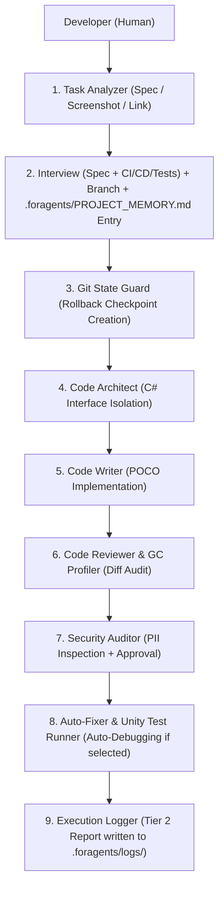

# 📘 Developer Guide & Architectural Manual: Unity 6 AI Workflow

> **Package:** `Unity6-AI-Workflow` (`.agents`)  
> **Compatibility:** Unity 6, VContainer, UniTask, R3, Antigravity IDE (Gemini 3.6 Flash / Claude 3.7)  
> **OS:** Windows, macOS, Linux (Dual Shell: PowerShell `.ps1` + Bash `.sh` + Python `ci/runner.py`)  
> *Read this documentation in Russian: [DOCUMENTATION_RU.md](DOCUMENTATION_RU.md)*

---

## 📑 Table of Contents

1. [Introduction & Purpose](#1-introduction--purpose)
2. [Package Capabilities & Ideology](#2-package-capabilities--ideology)
3. [Module Map: Subagents & Skills](#3-module-map-subagents--skills)
4. [Three-Tier Logging Architecture](#4-three-tier-logging-architecture)
5. [Setup & Usage Guide](#5-setup--usage-guide)
6. [Standard Operating Workflows (Use Cases)](#6-standard-operating-workflows-use-cases)
7. [Best Practices](#7-best-practices)

---

## 1. Introduction & Purpose

The **Unity 6 AI Workflow** package is a production-ready ecosystem of rules, subagent roles, skills, and automation scripts that transforms an AI coding assistant into an autonomous, safe, and predictable team contributor.

### Key Problems Solved by the Package:
* **Token Bloat & Context Creep**: Automatic task isolation between specialized subagents (each agent sees strictly its allocated slice of data).
* **Security & PII Leaks**: Enforces zero leakage of personal data, secret tokens, or hardcoded system paths via the mandatory **Human-in-the-Loop Protocol**.
* **Code Destruction Risk**: Automated Git checkpoint snapshots created prior to refactoring, allowing 1-click rollback.
* **Unity 6 Standards**: Mandatory compliance with VContainer POCO architecture, UniTask async handling, and zero-allocation `Tick()` loops.

---

## 2. Package Capabilities & Ideology



### Key Mechanics:
1. **Multimodal Task Analysis**: Accepts specs as text, Jira/GitHub links, or **UI/console screenshots**.
2. **CI/CD & Testing Interview**: At Step 0, interviews the developer on whether testing/builds are required (skip tests to save time / fast CI audit / full Unity test runner).
3. **Data Isolation (.foragents)**: Keeps the `.agents` package clean and reusable; all project memory and logs are stored in `.foragents/` at the root of the host project and tracked in project Git.
4. **Dual Shell & Python Runner**: 100% cross-platform script execution across Windows, macOS, and Linux.
5. **Provider-Agnostic CI/CD**: Pre-configured templates for GitHub Actions, GitLab CI, Bitbucket, and Azure DevOps.
6. **Self-Learning (`/learn`)**: Instant persistence of developer feedback into project memory `.foragents/PROJECT_MEMORY.md`.
7. **Meta-Agent (`Workflow Creator`)**: Autonomous generation of new skills and roles "on the fly" matching new project needs.

---

## 3. Module Map: Subagents & Skills

### 🤖 Specialized Subagents (`subagents/`):
* `task-analyzer.md` — Task spec analyzer, screenshot processor, clarification interview conductor, CI/CD interview, and Git branch orchestrator.
* `git-state-guard.md` — Repository state defender (creates `git stash` / `ai-checkpoint`).
* `code-architect.md` — C# contract and interface architect.
* `code-writer.md` — Isolated C# POCO code implementer.
* `code-reviewer.md` — `git diff` auditor checking VContainer and GC Zero-Alloc rules.
* `security-privacy-auditor.md` — PII security inspector enforcing **Human-in-the-Loop Protocol**.
* `auto-fixer.md` — Autonomous compilation and test error debugger (up to 2 attempts).
* `workflow-creator.md` — Meta-agent for skill and subagent profile generation.
* `test-engineer.md` — Unit and Integration test engineer (respects Developer Interview choice).
* `execution-logger.md` — Pipeline execution logger in `.foragents/logs/`.

### 🧬 Specialized Skills (`skills/`):
* `task-tracker` — Task card management and Git branch switching in `.foragents/PROJECT_MEMORY.md`.
* `memory-sync` — Auto-syncing `.foragents/PROJECT_MEMORY.md` from `git status` / `git diff`.
* `knowledge-learner` — Developer feedback persistence via `/learn`.
* `security-pii-scanner` — Scanner for secret keys, PII, and `C:\Users\` paths.
* `unity-test-runner` — Headless Unity Test Runner execution in `batchmode`.
* `ui-builder-validator` — UI Toolkit compliance audit (element names and SMACSS rules).
* `memory-gc-profiler` — Garbage allocation profiler for `Tick()` loops and `NativeArray` objects.
* `workflow-evolver` — Meta-skill for generating new skills.
* `execution-logger-skill` — Automated Tier 2 task execution reports in `.foragents/logs/`.

---

## 4. Three-Tier Logging Architecture

Logs are separated into 3 tiers for developer clarity and agent token efficiency:

* **🟢 Tier 1 (`.foragents/PROJECT_MEMORY.md`)**: High-level architectural status and active feature tracking stored in host project Git.
* **🟡 Tier 2 (`.foragents/logs/log_*.md`)**: Human-readable Markdown task protocols stored in host project Git for **Code Review during Pull Requests**.
* **🔴 Tier 3 (`brain/logs/`)**: Raw execution traces of Antigravity IDE tools stored locally per developer.

---

## 5. Setup & Usage Guide

### Step 1: Connecting Package to Unity 6 Project
Add the repository to your Unity project's `.agents` folder:

```bash
cd /path/to/your/UnityProject
git submodule add https://github.com/YourOrg/Unity6-AI-Workflow.git .agents
```

### Step 2: Installing Local Git Hooks
Execute the 1-click installer:

* **Windows (PowerShell)**:
  ```powershell
  .\.agents\hooks\install-hooks.ps1
  ```
* **macOS / Linux / Git Bash**:
  ```bash
  bash ./.agents/hooks/install-hooks.sh
  ```

---

## 6. Standard Operating Workflows (Use Cases)

### Workflow A: Implementing a Feature from Screenshot or Spec
1. Send the agent a screenshot of a UI layout or feature description.
2. `Task Analyzer` asks 2-3 clarifying questions and checks out branch `feature/task-102-ui-panel`.
3. `Code Architect` and `Code Writer` generate C# POCO classes and USS stylesheets.
4. `Code Reviewer` audits the diff, and `Execution Logger` generates a Tier 2 report in `.agents/logs/`.

### Workflow B: Safe Refactoring of Major Subsystems
1. Command the agent: *"Refactor MiningService to follow VContainer POCO rules"*.
2. `Git State Guard` automatically creates a localized rollback checkpoint.
3. If rollback is desired, run: `git reset --hard HEAD && git stash pop`.

### Workflow C: Teaching AI New Project Rules
1. Tell the agent: *"Resources.Load is forbidden in our project, use Addressables!"*.
2. Invoke `/learn`. The rule is automatically saved to `PROJECT_MEMORY.md` and respected across all future sessions.

---

## 7. Best Practices

1. **Perform Code Review via Tier 2 Logs**: When opening a Pull Request, inspect the generated Markdown report `.agents/logs/log_*.md` — it details all AI design decisions and audit passes.
2. **Preserve Human-in-the-Loop**: When security risks are flagged, review the proposed masking scheme before approving.
3. **Execute `ci/runner.py` Locally**: Running `python .agents/ci/runner.py` locally guarantees 100% build pass rates on CI servers.
