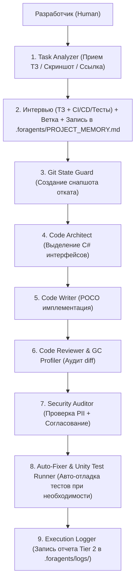

# 📘 Полное Руководство Разработчика и Архитектурный Справочник: Unity 6 AI Workflow

> **Пакет:** `Unity6-AI-Workflow` (`.agents`)  
> **Совместимость:** Unity 6, VContainer, UniTask, R3, Antigravity IDE (Gemini 3.6 Flash / Claude 3.7)  
> **ОС:** Windows, macOS, Linux (Dual Shell: PowerShell `.ps1` + Bash `.sh` + Python `ci/runner.py`)  
> *Документация на английском языке: [DOCUMENTATION.md](DOCUMENTATION.md)*

---

## 📑 Оглавление

1. [Введение и Назначение Пакета](#1-введение-и-назначение-пакета)
2. [Возможности Пакета и Идеология](#2-возможности-пакета-и-идеология)
3. [Карта Модулей: Субагенты и Навыки](#3-карта-модулей-субагенты-и-навыки)
4. [Трехуровневая Система Логирования](#4-трехуровневая-система-логирования)
5. [Инструкция по Подключению и Использованию](#5-инструкция-по-подключению-и-использованию)
6. [Типовые Сценарии Работы (Use Cases)](#6-типовые-сценарии-работы-use-cases)
7. [Лучшие Практики (Best Practices)](#7-лучшие-практики-best-practices)

---

## 1. Введение и Назначение Пакета

Пакет **Unity 6 AI Workflow** представляет собой готовую экосистему правил, ролей субагентов, навыков и скриптов автоматизации, превращающую ИИ-кодинг ассистента в автономного, безопасного и предсказуемого участника команды.

### Ключевые проблемы, которые решает пакет:
* **Утечка токенов и Bloat контекста**: Автоматическое разделение задач между изолированными субагентами (каждый агент видит только свой срез данных).
* **Безопасность и PII**: Запрет на утечку личных данных, токенов и хардкода системных путей с обязательным протоколом **Human-in-the-Loop**.
* **Риск испорченного кода**: Создание автоматических Git-снапшотов перед масштабными изменениями с возможностью отката в 1 клик.
* **Стандарты Unity 6**: Принудительное соблюдение POCO-архитектуры VContainer, UniTask и zero-allocation `Tick()` циклов.

---

## 2. Возможности Пакета и Идеология



### Ключевые Механики:
1. **Мультимодальный прием ТЗ**: Принимает задачи текстом, ссылками на Jira/GitHub или **скриншотами макетов/ошибок**.
2. **Интервью по CI/CD и тестам**: На шаге 0 модель проводит опрос разработчика о желании запускать тесты и CI/CD проверки (пропустить для экономии времени / быстрый CI аудит / полный прогон тестов).
3. **Изоляция данных и авто-инициализация (.foragents)**: Пакет `.agents` остается чистым и универсальным; память проекта и логи задач хранятся в `.foragents/` хост-репозитория и коммитятся в проект. При отсутствии `.foragents/` папка и шаблоны создаются автоматически.
4. **Стандарт Git: develop как default**: Рабочей базовой веткой проекта и пакета является `develop`. Все задачи ответвляются от `develop`, и все Pull Requests открываются в `develop`.
5. **Dual Shell & Python Runner**: 100% кроссплатформенная работа скриптов на Windows, macOS и Linux.
6. **Provider-Agnostic CI/CD**: Готовые конфигурации под GitHub Actions, GitLab CI, Bitbucket и Azure DevOps.
7. **Самообучение (`/learn`)**: Мгновенная фиксация замечаний разработчика в память проекта `.foragents/PROJECT_MEMORY.md`.
8. **Мета-Агент (`Workflow Creator`)**: Автоматическое создание новых навыков и ролей "на лету" под новые задачи проекта.


---

## 3. Карта Модулей: Субагенты и Навыки

### 🤖 Специализированные Субагенты (`subagents/`):
* `task-analyzer.md` — Аналитик ТЗ, скриншотов, интерфейс уточнения, интервью по тестам и оркестратор Git-веток.
* `git-state-guard.md` — Защитник состояния (создает `git stash` / `ai-checkpoint`).
* `code-architect.md` — Проектировщик C# контрактов и интерфейсов.
* `code-writer.md` — Исполнитель POCO-кода в изолированном контексте.
* `code-reviewer.md` — Аудитор `git diff` на соответствие VContainer и GC Zero-Alloc.
* `security-privacy-auditor.md` — Проверка безопасности PII и интерфейс **Human-in-the-Loop**.
* `auto-fixer.md` — Автономный фикс ошибок компиляции и упавших тестов (до 2 попыток).
* `workflow-creator.md` — Мета-агент генерации новых навыков и ролей.
* `test-engineer.md` — Инженер Unit и Integration тестов (с учетом выбора в интервью).
* `execution-logger.md` — Протоколист итогов вызовов в `.foragents/logs/`.

### 🧬 Специализированные Навыки (`skills/`):
* `task-tracker` — Управление ветками и статусом задач в `.foragents/PROJECT_MEMORY.md`.
* `memory-sync` — Авто-синхронизация `.foragents/PROJECT_MEMORY.md` из `git status` / `git diff`.
* `knowledge-learner` — Запоминание новых правил по команде `/learn`.
* `security-pii-scanner` — Сканер личных путей `C:\Users\`, токенов и API-ключей.
* `unity-test-runner` — Headless прогон Unity Test Runner в режиме `batchmode`.
* `ui-builder-validator` — Аудит UI Toolkit: уникальные имена интерактивных элементов, SMACSS USS правила.
* `memory-gc-profiler` — Поиск мусорных аллокаций в `Tick()` и вызовов `NativeArray`.
* `workflow-evolver` — Мета-навык конструирования новых навыков.
* `execution-logger-skill` — Авто-генерация протоколов выполнения задач Tier 2 в `.foragents/logs/`.

---

## 4. Трехуровневая Система Логирования

Логи разделены на 3 уровня для удобства разработчиков и агентов:

* **🟢 Tier 1 (`.foragents/PROJECT_MEMORY.md`)**: Память актуального архитектурного состояния проекта и список активных задач. Хранится в Git хост-проекта.
* **🟡 Tier 2 (`.foragents/logs/log_*.md`)**: Читаемые Markdown-отчеты по каждой фиче (Inputs, Outputs, Checklists, Summary). Хранятся в `.foragents/logs/` хост-проекта для удобного **Code Review при Pull Request**.
* **🔴 Tier 3 (`brain/logs/`)**: Сырые системные трассировки вызовов Antigravity IDE. Хранятся локально у каждого разработчика.

---

## 5. Инструкция по Подключению и Использованию

### Шаг 1: Подключение к Unity 6 проекту
Скопируйте репозиторий в папку `.agents` вашего проекта:

```bash
cd /path/to/your/UnityProject
git submodule add https://github.com/YourOrg/Unity6-AI-Workflow.git .agents
```

### Шаг 2: Установка локальных Git-хуков
Запустите скрипт установки в 1 клик:

* **Windows (PowerShell)**:
  ```powershell
  .\.agents\hooks\install-hooks.ps1
  ```
* **macOS / Linux / Git Bash**:
  ```bash
  bash ./.agents/hooks/install-hooks.sh
  ```

---

## 6. Типовые Сценарии Работы (Use Cases)

### Сценарий А: Разработка фичи по скриншоту / ТЗ
1. Отправьте агенту скриншот макета UI или описание задачи.
2. `Task Analyzer` проверяет наличие `.foragents/` (создает при отсутствии), задает 2-3 уточняющих вопроса и создает ветку `feature/task-102-ui-panel` от `develop`.
3. `Code Architect` и `Code Writer` создадут C# POCO классы и CSS стили.
4. `Code Reviewer` проверит diff, а `Execution Logger` создаст отчет в `.foragents/logs/`.
5. Создается Pull Request в ветку `develop`.

### Сценарий Б: Безопасный рефакторинг крупного модуля
1. Скажите агенту: *"Выполни рефакторинг MiningService под VContainer"*.
2. `Git State Guard` автоматически создаст локальную контрольную точку отката.
3. При необходимости отката выполните: `git reset --hard HEAD && git stash pop`.

### Сценарий В: Обучение ИИ новым правилам проекта
1. Напишите агенту: *"В нашем проекте нельзя использовать Resources.Load, только Addressables!"*.
2. Вызовите навык `/learn`. Замечание автоматически запишется в `.foragents/PROJECT_MEMORY.md` и будет учитываться во всех будущих сессиях.

---

## 7. Лучшие Практики (Best Practices)
1. **Проводите Code Review по Tier 2 логам**: При открытии Pull Request в `develop` читайте сгенерированный маркдаун файл `.foragents/logs/log_*.md` — он содержит обоснование всех решений ИИ.
2. **Не отключайте Human-in-the-Loop**: При обнаружении чувствительных данных всегда проверяйте предлагаемую схему маскирования.
3. **Запускайте `ci/runner.py` перед пушем**: Локальный прогон `python .agents/ci/runner.py` гарантирует 100% прохождение билда на CI-сервере.

