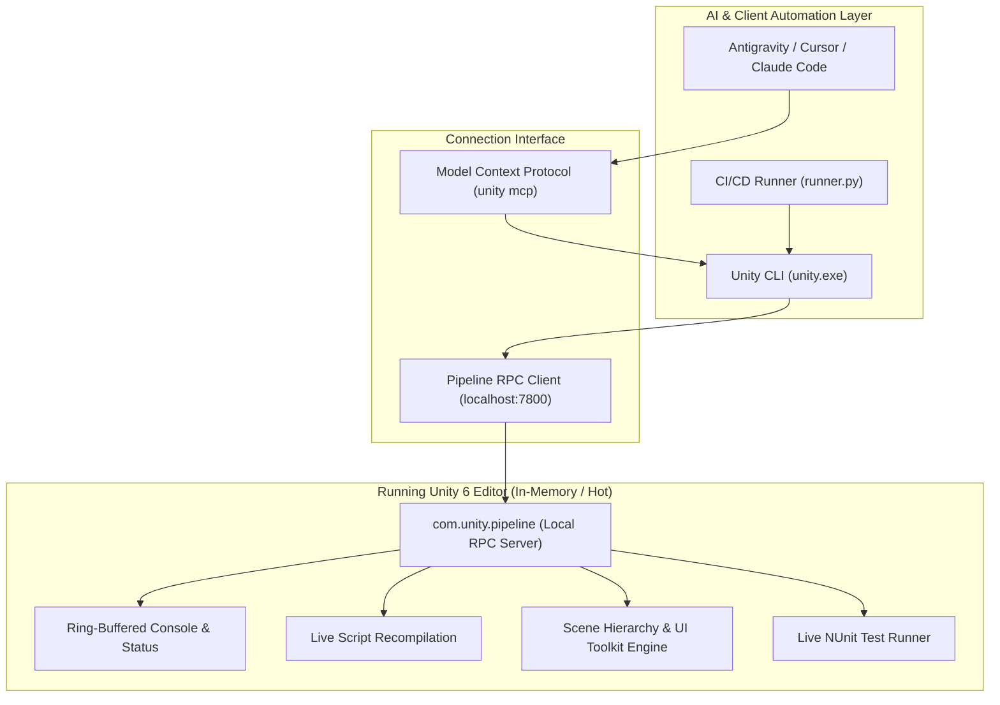

# ⚡ Unity CLI: Architecture, Capabilities & AI Agent Integration Guide

> **Ecosystem:** Unity 6 (`6000.x`), Antigravity IDE, Claude Code, Cursor, SUIF Framework  
> **Core Packages:** `com.unity.pipeline (0.9.1-exp.1+)`  
> **Unity CLI Version:** `1.0.0-beta.13+`  
> **Mandatory Policy:** Standardized across `unity6-ai-workflow` for compilation, testing, live editor introspection, and token budget optimization.

---

## 🎯 1. Overview & Paradigm Shift

Historically, automation and AI pair-programming in Unity relied on invoking the heavy `Unity.exe` desktop binary with batch flags:
```bash
# Legacy BatchMode Execution (Deprecated for Interactive AI Workflows)
Unity.exe -batchmode -nographics -projectPath ... -executeMethod ... -quit -logFile ...
```

### Critical Flaws of the Legacy Approach:
1. **Asset Database Locks (`UnityLockfile`):** Cannot run tests, recompilation, or builds while the developer has the project open in the Unity Editor.
2. **Cold-Start Overhead:** Spawning a cold Unity instance takes 30 to 90 seconds just to initialize the native engine and reload script assemblies.
3. **Fragile Log Parsing:** AI agents were forced to parse multimegabyte, unstructured `Editor.log` text files, blowing through token budgets and missing errors.
4. **Zero Introspection:** Impossibility of querying scene hierarchy, active GameObjects, or UI Toolkit elements during play mode.

---

## 🌟 2. The New Standard: Official Standalone Unity CLI (`unity`)

Unity 6 introduces the official standalone **Unity CLI** binary (`unity` / `unity.exe`) coupled with the **`com.unity.pipeline`** package.

Instead of cold-booting separate editor instances, the Unity CLI connects directly to a **warm, running Unity 6 Editor** via local RPC/HTTP on port `7800+`. It turns the open Unity Editor into an addressable, ultra-fast automation server.



---

## 🚀 3. Core Capabilities & Command Reference

### 3.1. Live Editor Status (`unity status`)
Inspects all active Unity Editor instances on the machine:
```bash
unity status
```
*Output:*
```text
Port    State    Project                  Version        PID
7800    ready    E:\GIT\SUIF_APPEARENCE   6000.6.7f1     22892
```

### 3.2. Real-Time Console & Compilation Status (`observability/console`)
Provides instant, structured JSON status without opening or reading `Editor.log`:
```bash
# Get compilation and error summary
unity cmd console status

# Output:
# {"compilationFailed": false, "compiling": false, "consoleErrors": 0, "consoleWarnings": 0}
```

To fetch actual errors with complete stack traces:
```bash
# Retrieve only errors
unity cmd console get --level error

# Clear captured buffer and editor console
unity cmd console clear
```

### 3.3. Live Script Recompilation (`unity recompile`)
Forces the open editor to refresh assets, compile domain assemblies, and report compilation results immediately:
```bash
unity recompile
```
* Returns exit code `0` on clean build, or returns exact compiler errors (`CS0246`, `CS0103`) with line numbers in seconds.

### 3.4. Sub-Second Test Execution (`unity test`)
Executes EditMode and PlayMode tests inside the warm running editor:
```bash
# Run EditMode tests
unity test --mode EditMode

# Run only affected tests based on git changes
unity test --affected

# Run specific test namespace or fixture
unity test --filter "SUIF.Tests.Core"
```
* **Performance Gain:** Execution drops from **45 seconds** (legacy batchmode) to **1.5 seconds** in the warm editor!

### 3.5. Live C# Evaluation & Scene Control (`unity cmd eval` & PlayMode)
Executes arbitrary C# inside the running editor or switches PlayMode:
```bash
# Toggle PlayMode
unity cmd editor_play

# Evaluate C# expression or trigger UI window creation
unity cmd eval 'new UnityEngine.GameObject("AutomationRoot");'
```

---

## ⚡ 4. Token Budget Optimization with Unity CLI

Feeding raw log files (`Editor.log`, batchmode terminal logs) into an LLM context consumes **10,000 to 50,000+ tokens** per iteration and frequently causes context truncation.

By enforcing the Unity CLI standard across agents and skills:
1. **Precise JSON Payloads:** Agents query `unity cmd console status` (consuming **~40 tokens**).
2. **Surgical Error Isolation:** When `consoleErrors > 0`, agents retrieve only the specific failed log entries via `unity cmd console get --level error` (consuming **~200 tokens** instead of an entire log file).
3. **Zero Polling Loops:** Fast synchronous execution prevents agent retry churn.

---

## 🤖 5. Official Model Context Protocol (MCP) Setup

Unity CLI includes native, out-of-the-box configuration for MCP across major AI agent tools:

```bash
# Configure Antigravity IDE
unity mcp configure antigravity

# Configure Cursor
unity mcp configure cursor --local

# Configure Claude Code CLI
unity mcp configure claude-code
```

### Pricing & Licensing Note:
The Unity CLI, `com.unity.pipeline`, and the MCP Server are **100% free** and included with Unity 6 (available on Personal, Pro, Enterprise). It runs locally on your workstation over standard stdio / localhost and requires **no paid cloud seats or subscriptions**.

---

## 📐 6. Architectural Integration in `unity6-ai-workflow`

| Subagent / Skill | Legacy Workflow (v1.2) | Modern Unity CLI Workflow (v1.3+) |
| :--- | :--- | :--- |
| **`Auto-Fixer`** | Read raw `Editor.log`, parse stack trace regexes. | Call `unity recompile`, inspect `unity cmd console status` & `get --level error`. |
| **`Test Engineer`** | Launch heavy `-batchmode` Unity process (fails if editor is open). | Execute `unity test --mode EditMode` directly in warm editor. |
| **`Code Reviewer`** | Static analysis only. | Static checks + live recompile verification via `unity recompile`. |
| **`Live Verifier`** | None (manual developer testing). | Automated PlayMode entry, UI element inspection via `eval`, and console health checks. |
