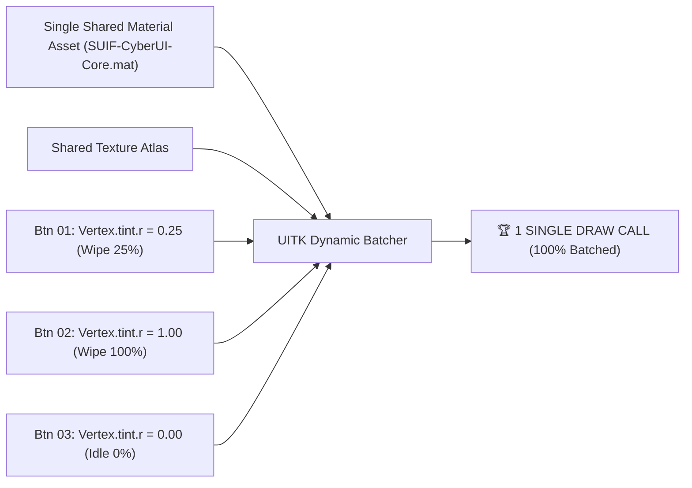

# SUIF Visual Effects & Animation Architecture (Unity 6 UI Toolkit)

> **Mandatory Rule:** All dynamic visual effects, chamfered/angled contours, hover wipes, and transitions across SUIF components must follow the **GPU-Driven Vertex Injection Pattern** to maximize dynamic batching (1 Draw Call for all elements), ensure zero heap allocations, and eliminate CPU main-thread render overhead.

---

## 🏛️ 1. Executive Summary & Architectural Tenets

| Axis | Standard Rule | Prohibited Anti-Pattern |
| :--- | :--- | :--- |
| **Batching** | **Default UITK shader (`MeshGenerationContext.Allocate`)** or **1 shared static Material Asset** across like elements | Creating runtime instances via `new Material(shader)` per element, or splitting default UITK batches unnecessarily |
| **Clipping** | **Stack-only polygon clipping** (Sutherland-Hodgman) or **GPU-Math Fragment Clipping** (`smoothstep`) | DOM `overflow: hidden` with rotated/skewed child pseudo-elements (`Stencil` batch break) |
| **Animation Driving** | **Transition-scoped `IVisualElementScheduledItem`** (`0` cost at rest) or **Vertex Attribute Stream / GPU `_Time`** | Continuous unconditional `MarkDirtyRepaint()` every frame in `ITickable.Tick()` when idle |
| **Memory & GC** | **0 B (Zero-Alloc)** stack buffers (`Span<Vector2>`) & struct-based value lerpers | Heap closures (`Action`, `Func`), Coroutines, or `MonoBehaviour` drivers |
| **Anti-Aliasing** | **Subpixel AA** via screen-space derivatives (`fwidth()`) or native triangle geometry | Jagged pixel boundaries or expensive multi-pass MSAA buffers |

---

## ⚡ 2. Batching Architecture: Default-Shader vs Single Shared Material

### 2.0. Default-Shader Geometry Injection (Preferred for Vector Wipes & Chamfers)
Assigning a custom `Material` (`unityMaterial`) creates a material boundary against surrounding default `Internal-UIRDefault` `VisualElement`s and `Label`s. For solid/angled vector fills, wipes, and chamfers:
* Render directly on the **default UI Toolkit shader** (`material == null`, `TextureId.invalid`) via `generateVisualContent` and `MeshGenerationContext.Allocate(...)`.
* Clip geometry on the stack (`Span<Vector2>` Sutherland-Hodgman or direct triangle construction) so **`overflow: hidden` and stencil buffers are never triggered**.
* Allocate **`0` vertices** in idle and active-locked states; schedule `MarkDirtyRepaint()` strictly during active transition windows (`0.12s–0.16s`) and pause immediately upon completion.

### 2.1. The Single Shared Material Pattern (For Custom Fragment Effects)
In Unity 6 UI Toolkit, when custom fragment shading is required across a homogeneous group of elements, dynamic batching merges elements sharing the same **Texture Atlas** and **Material Asset**: 

* **The Problem:** Modifying material uniforms (`material.SetFloat("_HoverProgress", val)`) requires creating unique material instances, forcing $N$ Draw Calls for $N$ elements.
* **The SUIF Solution:** All interactive elements bind to **one shared static Material asset** (`SUIF-CyberUI-Core.mat`). Individual dynamic state is packed directly into per-element **Vertex Data** (`Vertex.tint` or secondary UVs):



### 2.2. Vertex Attribute Packing Protocol
When rendering custom quads or procedural elements via `MeshGenerationContext`:

| Vertex Attribute | Target Parameter | Range | Description |
| :--- | :--- | :--- | :--- |
| **`Vertex.tint.r`** | `HoverProgress` | `0.0 .. 1.0` | Normalized progress of diagonal wipe / transition front. |
| **`Vertex.tint.g`** | `ChamferNormalized` | `0.0 .. 1.0` | Corner cut ratio relative to element dimensions. |
| **`Vertex.tint.b`** | `StateFlags` | `0, 1, 2, 3` | Encoded flags (0: Normal, 1: Active, 2: Disabled, 3: Danger). |
| **`Vertex.tint.a`** | `BaseOpacity` | `0.0 .. 1.0` | Global opacity multiplier. |

---

## 🚫 3. Prohibited Approaches (Anti-Patterns)

### 3.1. Prohibition of DOM `overflow: hidden` + Rotated Pseudo-Elements
* **Prohibited:** Creating angled hover wipes by placing an inner element with `rotate(15deg)` or `transform: skew` inside a container with `overflow: hidden`.
* **Reason:** In UITK, rotated children inside clipped containers cannot be clipped by hardware Scissor Rects. UITK forces Stencil buffer allocation and breaks batching, transforming a 10-button menu into 25–40 separate draw calls.

### 3.2. Prohibition of Unconditional Per-Frame `Painter2D` Animation
* **Prohibited:** Calling `MarkDirtyRepaint()` on every frame inside `ITickable.Tick()` even when visuals are idle/static.
* **Reason:** Re-triangulating contours and uploading vertex buffers (`UploadMesh`) at 60–120 FPS wastes main-thread CPU and prevents batch reuse.
* **Allowed Use for `generateVisualContent`:**
  1. Static or resize-only vector geometry (`0` per-frame work).
  2. Transition-scoped `MeshGenerationContext.Allocate` effects driven by `IVisualElementScheduledItem` strictly during hover/press transitions (`0` vertices when idle, immediately paused when settled).

---

## 🧮 4. Mathematical GPU Shader Formulation

All diagonal wipes, chamfers, and edge contours are calculated analytically in the fragment shader with subpixel anti-aliasing:

```hlsl
float4 EvaluateCyberWipe(float2 uv, float progress, float chamferSize, float4 baseColor, float4 activeColor)
{
    const float slope = 0.35;
    float frontLine = uv.x + (1.0 - uv.y) * slope;
    float scaledProgress = progress * (1.0 + slope);

    float aa = fwidth(frontLine) * 1.5;
    float wipeMask = smoothstep(frontLine - aa, frontLine + aa, scaledProgress);

    float cornerSum = uv.x + uv.y;
    float cornerCut = step(cornerSum, 2.0 - chamferSize);

    float4 finalColor = lerp(baseColor, activeColor, wipeMask);
    finalColor.a *= cornerCut;
    return finalColor;
}
```

---

## 🔄 5. Zero-Allocation Animation Drivers

1. **Pure Struct Lerpers**:
   - Animation transitions must use unmanaged struct-based interpolators (`ValueAnimation<float>`).
   - Do not allocate lambda expressions (`Action<float>`) in frame loops.
2. **UniTask & R3 Integration**:
   - Drive value transitions via value-task loops using `CancellationToken`:
     ```csharp
     public async UniTask AnimateHoverAsync(float targetProgress, CancellationToken ct)
     {
         float start = CurrentProgress;
         float elapsed = 0f;
         while (elapsed < Duration)
         {
             ct.ThrowIfCancellationRequested();
             elapsed += Time.unscaledDeltaTime;
             float t = Mathf.Clamp01(elapsed / Duration);
             CurrentProgress = Mathf.Lerp(start, targetProgress, EaseOutExpo(t));
             ApplyVertexTint(CurrentProgress);
             await UniTask.Yield(PlayerLoopTiming.Update, ct);
         }
     }
     ```
3. **GPU-Time Autonomy**:
   - For cyclical ambient effects (e.g., scanning lines, radar sweeps, pulsing glows), use GPU `_Time.y` in the shader graph directly. Zero C# CPU code or ticking required.

---

## 📝 6. Dynamic Text & Foreground Inversion Protocol

When a high-contrast angled wipe sweeps across a button:
1. **Shader Inversion**: If text/icon is integrated into the procedural quad, color inversion occurs in a single pass via `lerp(NormalTextCol, InvertedTextCol, wipeMask)`.
2. **TextCore Dual-Binding**: If using standard UITK `Label` (TextCore SDF font), synchronize the label's CSS transition duration to match the wipe duration:
   ```css
   .fui-btn-label {
       color: var(--fg-primary);
       transition-property: color;
       transition-duration: 0.18s;
       transition-timing-function: ease-out-expo;
   }
   .fui-btn:hover .fui-btn-label {
       color: #050507;
   }
   ```

---

## 🎯 7. UI-Only Scene URP & Multi-Platform Quality Checklist

When optimizing UI-only scenes (Screen Space - Overlay `UIDocument` with zero 3D world geometry):
1. **Camera Overhead Removal**: Set `Main Camera` `CullingMask = 0` and disable `HDR`, `MSAA`, `Shadows`, `DepthTexture`, `OpaqueTexture`, `PostProcessing`, `AllowXRRendering`, and `AllowHDROutput`; match background color to the UI root color.
2. **All Active `QualitySettings` Platforms**: Inspect `ProjectSettings/QualitySettings.asset` across **every** build target (`Standalone`, `WebGL`, mobile) and disable unused Renderer Features (e.g., `ScreenSpaceAmbientOcclusion`) on all active URP Renderer assets, not just the Editor's active tier.
3. **Separate UI vs URP Attribution**: Measure UI Toolkit batching (`UIRenderDevice.GatherDrawStatistics()`) independently from camera/URP pass overhead before refactoring UI shaders or DOM hierarchies.
